# TaskManager

チームのタスクを、プロジェクトごとに「誰が・いつまでに・どの状態か」で管理する Web アプリケーションです。
自分の担当タスクを期限ごとに確認でき、表・ボード・ガントチャートでの一覧、ステータス別の円グラフ、コメント、ファイルの添付、お知らせに対応しています。

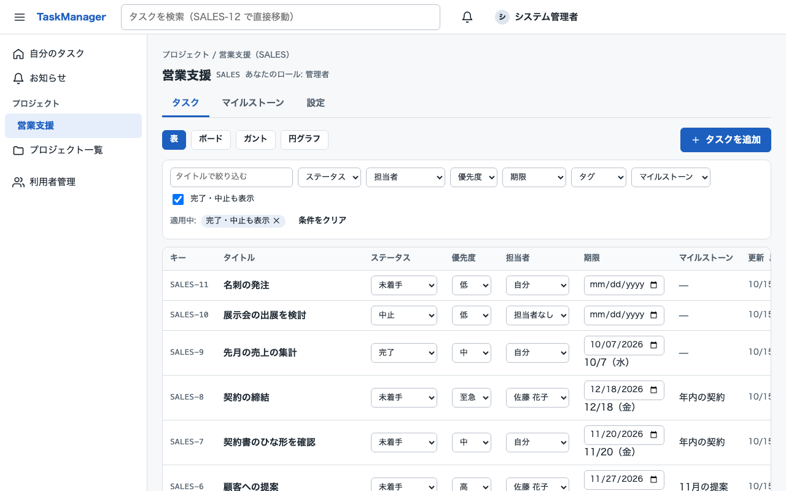

## 目次

1. [主な機能](#1-主な機能)
2. [画面](#2-画面)
3. [技術構成](#3-技術構成)
4. [ディレクトリ構成](#4-ディレクトリ構成)
5. [必要なもの](#5-必要なもの)
6. [セットアップと起動（Docker）](#6-セットアップと起動docker)
7. [環境変数（.env）](#7-環境変数env)
8. [データベースとマイグレーション](#8-データベースとマイグレーション)
9. [開発時の起動（Backend・Frontend を個別に起動）](#9-開発時の起動backendfrontend-を個別に起動)
10. [Swagger / OpenAPI](#10-swagger--openapi)
11. [テスト](#11-テスト)
12. [セキュリティ](#12-セキュリティ)
13. [開発の進め方](#13-開発の進め方)
14. [ドキュメント](#14-ドキュメント)

## 1. 主な機能

| 機能 | 内容 |
|---|---|
| ログイン | メールアドレスとパスワード。初回は一時パスワードからの変更が必須。5 回失敗で 15 分ロック |
| 自分のタスク | 担当タスクを「期限切れ・今日まで・今週・それ以降・期限なし」に分けて表示（利用者のタイムゾーン基準） |
| プロジェクト | 作成・アーカイブ・削除（削除はシステム管理者）、メンバーとロール（管理者・編集者・閲覧者） |
| タスク | 表（その場で編集・絞り込み・並べ替え）、ボード（ステータス別）、詳細、サブタスク（1 段）、タグ、マイルストーン、変更履歴 |
| ガントチャート | 開始日〜期限の横棒、表示単位（日・週・月）、前へ / 今日 / 次へ、今日の線、期限切れの表示、担当者・ステータス・マイルストーンでまとめる、棒のドラッグでの日程変更（表形式の代替表示の日付欄でも変更可）、日付が未設定のタスクの一覧 |
| ステータス別の割合 | プロジェクトのタスクと自分の担当タスクを、ステータスごとの件数と割合（円グラフ + 表）で表示。0 件のステータスも表示し、合計は 100.0% |
| コメント・添付 | Markdown のコメント、ファイルの添付（PDF・画像・Office・テキスト・ZIP、10MB まで） |
| お知らせ | 担当になった・コメントされた・完了した・プロジェクトに追加された |
| 検索 | タスクのタイトル検索、`SALES-12` のようなキーで直接移動 |
| 利用者管理 | システム管理者による利用者の発行（一時パスワード）・停止・ロック解除・パスワード再発行 |

画面の文言・エラー・お知らせはすべて日本語です。スマートフォン幅にも対応しています。

## 2. 画面

| ログイン | 自分のタスク |
|---|---|
| 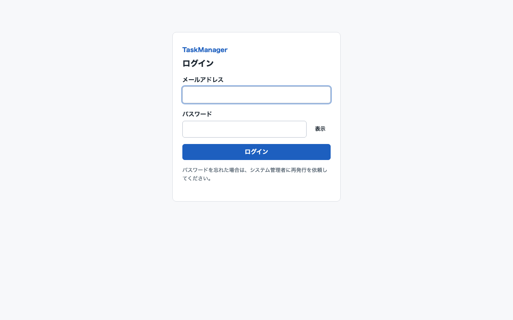 | 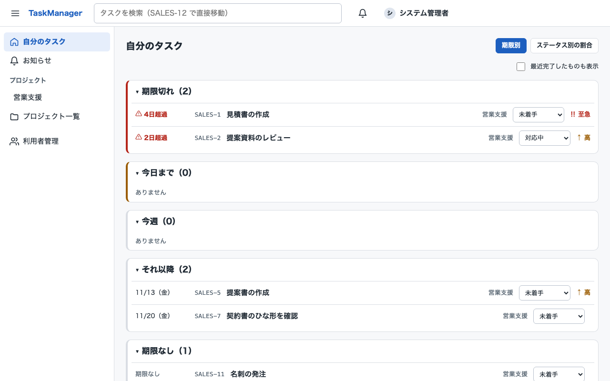 |

| ボード | タスクの詳細 |
|---|---|
| 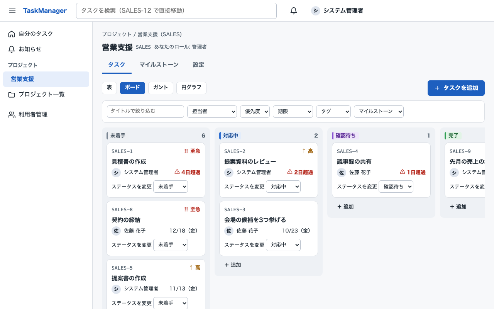 | 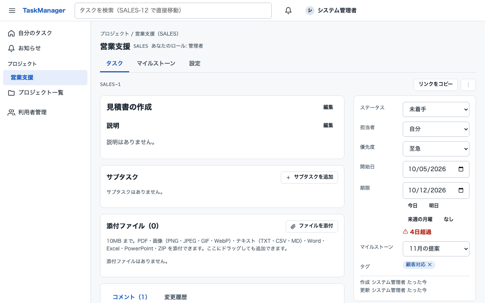 |

| 利用者管理 | スマートフォン幅 | Swagger UI（開発時） |
|---|---|---|
| 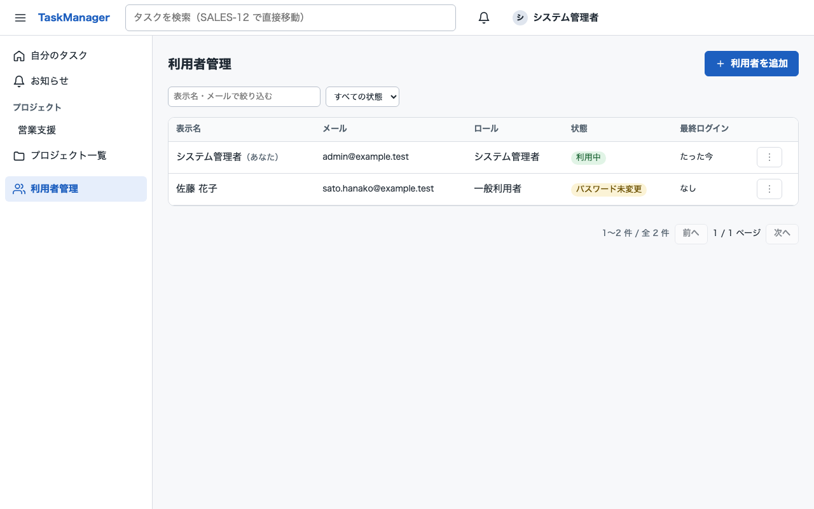 | 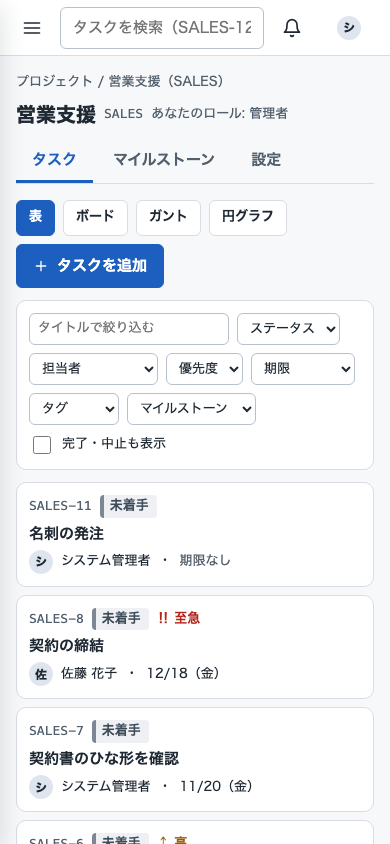 | 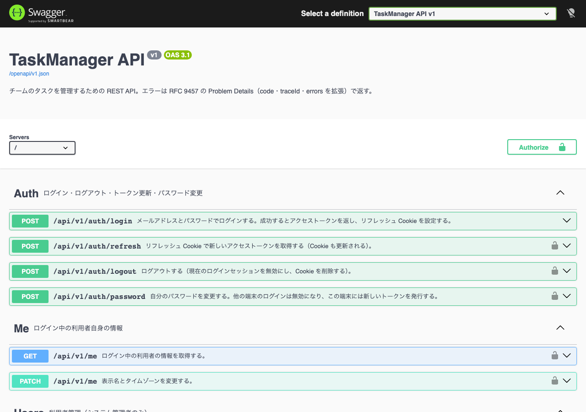 |

### ガントチャート・ステータス別の割合

タスクの画面の表示形式（表 / ボード / **ガント** / **円グラフ**）で切り替えます。

| ガントチャート（週・担当者でまとめる） | ガントチャート（月・マイルストーンでまとめる） |
|---|---|
| 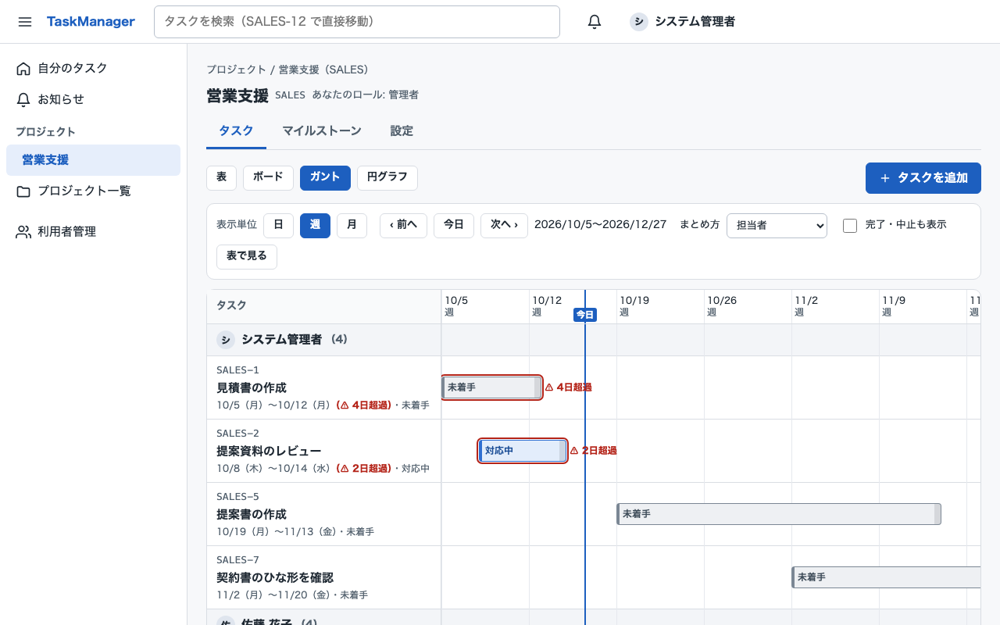 | 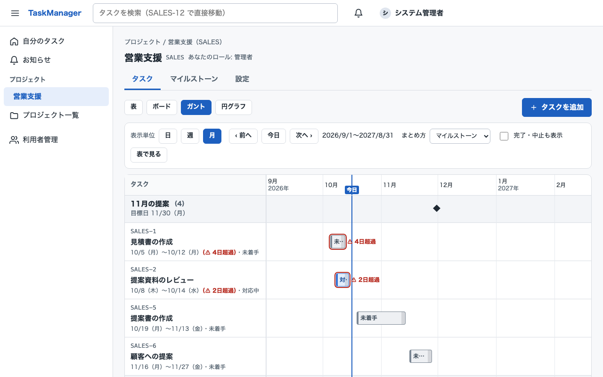 |

- 棒は開始日〜期限。色と文字がステータス、⚠ と「◯日超過」が期限切れ、縦線が今日、◆ がマイルストーンの目標日です。
- 編集者以上は、棒をドラッグすると日程を、右端をドラッグすると期限を変更できます。キーボードでは「表で見る」の日付欄で変更できます。

| プロジェクトのステータス別の割合 | 自分のタスクのステータス別の割合 |
|---|---|
| 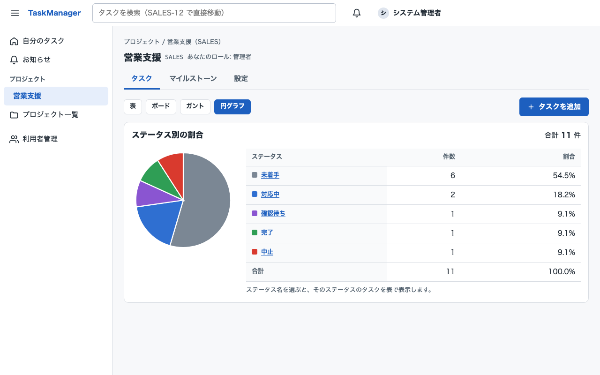 | 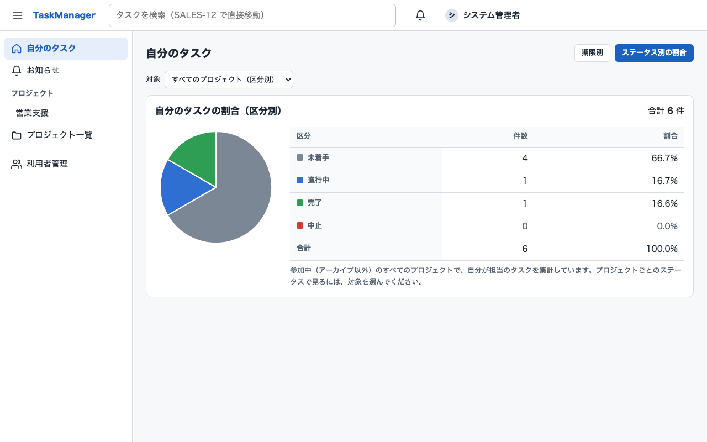 |

- プロジェクトのステータス定義（名前・色・並び順）のまま、0 件のステータスも含めて件数と割合を表示します。ステータス名を選ぶと、そのステータスのタスクの表へ移動します。
- 「自分のタスク」では、すべてのプロジェクトをステータスの区分（未着手・進行中・完了・中止）で、プロジェクトを選ぶとそのプロジェクトのステータスで表示します。

画面はすべて Docker 構成で起動した状態のキャプチャです（データは架空）。

## 3. 技術構成

| 区分 | 技術 |
|---|---|
| Backend | C# / ASP.NET Core（.NET 10）、REST API、JWT（HS256）+ リフレッシュ Cookie |
| DB アクセス | Entity Framework Core 10（MySql.EntityFrameworkCore）、EF Core Migration |
| DB | MySQL 8.4（Docker）。開発・テストではローカルの MySQL 8.0 でも動作確認済み |
| API 仕様 | OpenAPI 3.1（ビルド時に生成し `docs/api/openapi.v1.json` を契約として管理）、Swagger UI |
| Frontend | React 19、TypeScript 5.9、Vite 8、React Router 8、TanStack Query 5、react-hook-form + zod、react-aria-components |
| テスト | xUnit v3、WebApplicationFactory、Testcontainers、Vitest + Testing Library + MSW、Playwright + axe |
| 実行環境 | Docker Compose（Linux コンテナ: nginx・ASP.NET Core・MySQL） |

構成の詳細: [docs/design/architecture.md](docs/design/architecture.md)

```text
ブラウザ ──HTTP──▶ web（nginx: 画面の配信 + /api を中継）──▶ api（ASP.NET Core）──▶ db（MySQL）
                   公開ポート 8080                           内部ネットワークのみ        内部ネットワークのみ
```

## 4. ディレクトリ構成

```text
TaskManager/
├── src/                          Backend
│   ├── TaskManager.Domain/         業務ルール（Entity・値オブジェクト）
│   ├── TaskManager.Application/    ユースケース・DTO・検証・認可判定
│   ├── TaskManager.Infrastructure/ EF Core・MySQL・マイグレーション・パスワードハッシュ・添付の保存
│   ├── TaskManager.Api/            Controller・認証・Swagger/OpenAPI・ミドルウェア
│   └── TaskManager.sln
├── tests/                        Backend のテスト（Domain・Application・Infrastructure・API・共通部品）
├── frontend/
│   ├── task-manager-web/           画面（React + Vite）。src/**/*.test.tsx が画面のテスト
│   └── task-manager-e2e/           E2E テスト（Playwright）
├── docker/                       Dockerfile（api・web・mysql）、nginx 設定、MySQL の初期化スクリプト
├── docker-compose.yml            全体構成（本番相当）
├── docker-compose.dev.yml        開発用の上書き（DB と API を 127.0.0.1 に公開、Swagger を有効化）
├── .env.example                  環境変数の雛形（Secret は空欄）
└── docs/                         解析・設計・環境・実装・テスト・セキュリティ・完成確認の記録
```

## 5. 必要なもの

| 用途 | 必要なもの |
|---|---|
| Docker で動かす | Docker Desktop（Docker Compose v2）、`openssl`（Secret の生成） |
| 開発・テスト | 上記 + .NET SDK 10.0.400 以上、Node.js 24 以上 |

macOS で確認しています（Linux でも同じ手順で動きます）。

## 6. セットアップと起動（Docker）

コマンドだけを順に実行したい場合は [docs/build_Application/StartUp-Application.md](docs/build_Application/StartUp-Application.md) を参照してください。

```bash
cd TaskManager

# 1) 環境変数を用意する（Secret は必ず新しく生成する。§7）
cp .env.example .env && chmod 600 .env
#   .env を開き、MYSQL_ROOT_PASSWORD・TM_DB_APP_PASSWORD・TM_DB_MIGRATOR_PASSWORD に `openssl rand -hex 24` の値、
#   TM_JWT_SIGNING_KEY に `openssl rand -base64 48` の値、
#   TM_BOOTSTRAP_ADMIN_EMAIL / TM_BOOTSTRAP_ADMIN_PASSWORD に初期管理者のメールと一時パスワード（12 文字以上）を設定する

# 2) ビルドして起動する（初回は数分かかる）
docker compose up -d --build

# 3) 状態を確認する（db・api・web が healthy、migrate が Exited (0) になれば準備完了）
docker compose ps
```

ブラウザで **http://localhost:8080** を開き、初期管理者でログインします。初回はパスワードの変更を求められます。
その後、「利用者管理」から利用者を追加し、表示された一時パスワードを本人に伝えてください。

| 操作 | コマンド |
|---|---|
| ログを見る | `docker compose logs -f api` |
| 停止する（データは残る） | `docker compose down` |
| データも含めて消す | `docker compose down -v`（DB と添付ファイルが消えます） |

起動順序: `db（healthy）→ migrate（マイグレーションを適用して終了）→ api（healthy）→ web`。詳細: [docs/environment/docker.md](docs/environment/docker.md)

## 7. 環境変数（.env）

`.env` は Git に登録しません（`.gitignore` 済み）。Secret は `.env`（環境変数）だけで渡し、設定ファイルやイメージには含めません。

| 変数 | 必須 | 内容 |
|---|---|---|
| `MYSQL_ROOT_PASSWORD` | ○ | MySQL の root（初期化のみ。コンテナ内からのみ接続可） |
| `TM_DB_APP_PASSWORD` | ○ | アプリ用 DB 利用者（SELECT / INSERT / UPDATE / DELETE のみ） |
| `TM_DB_MIGRATOR_PASSWORD` | ○ | マイグレーション用 DB 利用者 |
| `TM_JWT_SIGNING_KEY` | ○ | JWT の署名鍵（Base64、32 バイト以上。不足していると API が起動しない） |
| `TM_BOOTSTRAP_ADMIN_EMAIL` / `TM_BOOTSTRAP_ADMIN_PASSWORD` | 初回 | システム管理者が 1 人もいないときだけ作成する初期管理者 |
| `TM_WEB_PORT` | | 画面の公開ポート（既定 8080） |
| `TM_ENABLE_SWAGGER` | | Swagger UI と OpenAPI 文書の公開（既定 false） |
| `TM_COOKIE_SECURE` | | リフレッシュ Cookie の Secure 属性（既定 true。http://localhost 以外の HTTP で動かす場合のみ false） |

パスワードは接続文字列に埋め込むため、`;` `'` `"` を含まない値（`openssl rand -hex 24` など）にしてください。
全項目: [docs/environment/configuration.md](docs/environment/configuration.md)

## 8. データベースとマイグレーション

- DB 名 `taskmanager_db`（utf8mb4）。表 14、外部キー 37、CHECK 制約 11。設計: [docs/design/database-design.md](docs/design/database-design.md)
- マイグレーション: `InitialSchema`、`AddTaskStatusSummaryIndex`（ステータス別集計用の索引。ガント・円グラフの追加時）
- Docker 構成では `migrate` コンテナが起動のたびに未適用のマイグレーションを適用します（API は未適用のマイグレーションがあると起動しません）。
- 初期データ: 初期管理者（`TM_BOOTSTRAP_ADMIN_*`）。プロジェクトを作ると、既定のステータス（未着手・対応中・確認待ち・完了・中止）が作られます。

| 操作 | コマンド |
|---|---|
| マイグレーションの追加（開発者） | `dotnet ef migrations add <名前> --project src/TaskManager.Infrastructure --startup-project src/TaskManager.Infrastructure` |
| 開発用 DB への適用 | `docker compose -f docker-compose.yml -f docker-compose.dev.yml run --rm migrate` |
| モデルとの差分の確認 | `dotnet ef migrations has-pending-model-changes --project src/TaskManager.Infrastructure --startup-project src/TaskManager.Infrastructure` |

### バックアップと復元

```bash
# バックアップ（db コンテナ内でソケット経由の root で取得し、ホストに保存する）
set -a; . ./.env; set +a
docker compose exec -T -e MYSQL_PWD="$MYSQL_ROOT_PASSWORD" db \
  mysqldump -uroot --single-transaction --routines taskmanager_db > backup-$(date +%Y%m%d).sql

# 復元（api を止めてから）
docker compose stop api
docker compose exec -T -e MYSQL_PWD="$MYSQL_ROOT_PASSWORD" db mysql -uroot taskmanager_db < backup-YYYYMMDD.sql
docker compose start api
```

添付ファイルはボリューム `taskmanager_tm-attachments` に保存されます。DB と同じ時点で一緒にバックアップしてください。

## 9. 開発時の起動（Backend・Frontend を個別に起動）

DB だけ Docker で動かし、API と画面はホットリロードできるようにローカルで動かします。

```bash
# 1) DB を起動してマイグレーションを適用（127.0.0.1:3307 に公開）
docker compose -f docker-compose.yml -f docker-compose.dev.yml up -d db migrate

# 2) API（http://localhost:5080、Swagger UI: http://localhost:5080/swagger）
set -a; . ./.env; set +a
export Jwt__SigningKey="$TM_JWT_SIGNING_KEY"
export ConnectionStrings__TaskManager="Server=127.0.0.1;Port=${TM_DB_PORT:-3307};Database=${TM_DB_NAME};User ID=${TM_DB_APP_USER};Password=${TM_DB_APP_PASSWORD};SslMode=Required"
export Bootstrap__AdminEmail="$TM_BOOTSTRAP_ADMIN_EMAIL" Bootstrap__AdminPassword="$TM_BOOTSTRAP_ADMIN_PASSWORD"
export Attachments__RootPath="$PWD/artifacts/attachments"
dotnet run --project src/TaskManager.Api --launch-profile http

# 3) 画面（別のターミナルで。http://localhost:5173。/api は 5080 に中継される）
cd frontend/task-manager-web && npm ci && npm run dev
```

| よく使うコマンド | 内容 |
|---|---|
| `dotnet build src/TaskManager.sln` | Backend のビルド（警告もエラー扱い）。OpenAPI 文書 `artifacts/openapi/openapi.json` も生成される |
| `npm run typecheck` / `npm run lint` / `npm run build` | Frontend の型チェック・lint・ビルド |
| `npm run generate:api` | OpenAPI のスナップショットから Frontend の API の型を生成する |

詳細: [docs/environment/local-development.md](docs/environment/local-development.md)

## 10. Swagger / OpenAPI

- OpenAPI 文書は **API の契約** として `docs/api/openapi.v1.json` に保存しています。実行中の API の文書と一致することをテストで確認しています。
- Swagger UI は開発時だけ有効です（`docker-compose.dev.yml` を使うか、`dotnet run` の Development 環境）。本番構成では公開しません。
  - 開発時: http://localhost:5080/swagger 、OpenAPI 文書: http://localhost:5080/openapi/v1.json
- 認証が必要な API は、Swagger UI の **Authorize** にログイン API で得たアクセストークンを入力して実行します（有効期限 15 分）。
- エラーはすべて RFC 9457 の Problem Details（`application/problem+json`。`code`・`traceId`・`errors` を追加）で返します。

API の一覧と仕様: [docs/design/api-design.md](docs/design/api-design.md)（64 操作。ガント・円グラフ用の `GET .../tasks/schedule`・`GET .../tasks/status-summary`・`GET /api/v1/me/tasks/status-summary` を含む）

## 11. テスト

| 種類 | コマンド | 件数（最終実行の結果） |
|---|---|---|
| Backend（Domain・Application・Infrastructure・API） | `TM_TEST_MYSQL_CONNECTION='Server=localhost;Port=3306;User ID=...;Password=...;SslMode=Required' dotnet test --solution src/TaskManager.sln` | 1,079 件 |
| Frontend（部品・画面） | `cd frontend/task-manager-web && npm run test` | 144 件 |
| E2E | `cd frontend/task-manager-e2e && TM_E2E_BASE_URL=http://localhost:8080 TM_E2E_ADMIN_EMAIL=... TM_E2E_ADMIN_PASSWORD=... npx playwright test` | 9 シナリオ |

- Backend のテストは MySQL を使います。`TM_TEST_MYSQL_CONNECTION`（DB を作成・削除できる利用者。`Database` は指定しない）を設定するとその MySQL に `tm_test_` で始まる DB を作って使い、設定しない場合は Testcontainers で MySQL 8.4 を起動します（Docker が必要）。
- E2E は、空の DB に初期管理者だけがいる状態（`docker compose down -v` → `up -d --build` の直後）で実行します。
- E2E はシナリオ全体で同じ送信元から 10 回を超えてログインするため、ログインの回数制限（10 回/分）に達した場合は 1 分待ってからやり直します（そのため 2〜3 分かかることがあります）。
- 結果: [docs/testing/test-results.md](docs/testing/test-results.md)、テストの一覧: [docs/testing/test-coverage.md](docs/testing/test-coverage.md)、ガント・円グラフの追加（Phase 9）: [docs/corrections/phase-09/verification-report.md](docs/corrections/phase-09/verification-report.md)

## 12. セキュリティ

| 対策 | 内容 |
|---|---|
| 認証 | パスワードは PBKDF2（ハッシュのみ保存）、12 文字以上・推測されやすいものを拒否、5 回失敗で 15 分ロック。アクセストークン（15 分）はメモリのみに保持し、リフレッシュトークンは HttpOnly・Secure・SameSite=Strict の Cookie |
| 認可 | 既定でログイン必須。プロジェクトに所属していない人には存在を明かさない（404）。全 API × 8 種類の利用者の権限をテストで確認 |
| 入力 | 全 API で入力を検証。SQL は LINQ とパラメータ化のみ。Markdown は生の HTML を無効化 |
| 添付 | 拡張子と中身の両方で種類を確認、10MB まで、保存名はサーバーで生成、ダウンロードは常にファイルとして保存 |
| 通信 | CSP などのセキュリティヘッダー、レート制限（ログイン 10 回/分 など）、refresh / logout は Origin を検証 |
| コンテナ | 全コンテナ非 root・ケーパビリティなし、DB と API は外部に公開しない、DB の root はコンテナ内からのみ |

- **HTTPS**: web コンテナは HTTP（8080）で待ち受けます。インターネットや社内に公開する場合は、前段のリバースプロキシ・ロードバランサーで HTTPS を終端し、HSTS を設定してください。
- 既存の環境を更新する場合、DB の root を「コンテナ内のみ」に制限する設定（`MYSQL_ROOT_HOST=localhost`）は新しく作る DB にしか反映されません。既存の DB では `DROP USER 'root'@'%';` を実行してください。
- レビュー結果: [docs/security/security-review.md](docs/security/security-review.md)

## 13. 開発の進め方

このリポジトリは、CLAUDE.md に定めた 8 つのフェーズ（解析 → 設計 → 環境構築 → 実装 → テストコード → テスト実行 → セキュリティ → 完成確認）で作りました。
その後、Phase 9（修正）でガントチャートとステータス別の円グラフを追加しました（調査・影響分析・変更記録・確認結果: [docs/corrections/phase-09/](docs/corrections/phase-09/)）。

API を変更するときの流れ:

```text
docs/design/api-design.md を更新
  → Controller / DTO を実装 → dotnet build（OpenAPI を生成）
  → 差分を確認して docs/api/openapi.v1.json を更新
  → npm run generate:api（Frontend の型を更新）→ npm run typecheck
  → テスト（スナップショットの一致・認可マトリクス）を実行
```

新しい API を追加したら、`tests/TaskManager.Api.Tests/Authorization/AuthorizationMatrix.cs` に 1 行追加してください（未登録だとテストが失敗します）。

## 14. ドキュメント

| 場所 | 内容 |
|---|---|
| [docs/analysis/](docs/analysis/) | 解析 |
| [docs/design/](docs/design/) | 要件・アーキテクチャ・DB・API・画面・セキュリティ・テストの設計 |
| [docs/environment/](docs/environment/) | 環境構築・設定・Docker・発生した問題 |
| [docs/implementation/](docs/implementation/) | 実装状況と設計からの変更 |
| [docs/testing/](docs/testing/) | テストの設計・一覧・実行結果 |
| [docs/security/](docs/security/) | セキュリティレビュー |
| [docs/completion/](docs/completion/) | 完成確認のチェックリスト・既知の課題 |
| [docs/build_Application/](docs/build_Application/) | アプリケーションの起動手順 |
| [docs/corrections/](docs/corrections/) | 完成後の修正の記録（Phase 9: ガントチャート・ステータス別円グラフ） |
