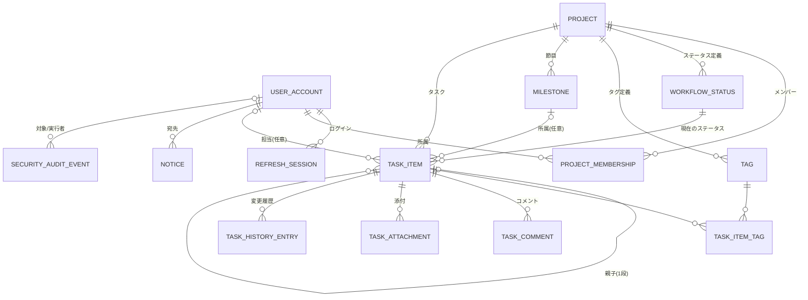

# ドメインモデル設計

TaskManager.Domain に置く Entity・Value Object・列挙・業務ルール（不変条件）を定義する。永続化の詳細は [database-design.md](database-design.md)、名前の理由は [naming-rules.md](naming-rules.md)。

## 1. 境界づけ（モジュール）

| モジュール | 集約ルート | 含む Entity | 説明 |
|---|---|---|---|
| アカウント | `UserAccount` | `RefreshSession` | ログイン・ロール・ロック |
| プロジェクト | `Project` | `ProjectMembership`, `WorkflowStatus`, `Tag`, `Milestone` | プロジェクトの設定と構成員 |
| タスク | `TaskItem` | `TaskItemTag`, `TaskComment`, `TaskAttachment`, `TaskHistoryEntry` | 仕事 1 件とその付随情報 |
| お知らせ | `Notice` | — | 利用者宛ての通知 |
| 監査 | `SecurityAuditEvent` | — | 追記専用 |

集約をまたぐ参照は ID のみで持つ（例: `TaskItem.AssigneeUserId`）。EF Core のナビゲーションは読み取りの便宜のため設定してよいが、集約をまたいだ更新はしない。

## 2. ER 図

## 3. 列挙

| 列挙 | 値（識別子 / 画面表示 / DB 値） | 備考 |
|---|---|---|
| `SystemRole` | `Member` / 一般利用者 / 1、`Administrator` / システム管理者 / 2 | |
| `ProjectRole` | `Viewer` / 閲覧者 / 1、`Editor` / 編集者 / 2、`Owner` / 管理者 / 3 | 数値の大小で権限の包含関係を表す |
| `StatusCategory` | `NotStarted` / 未着手 / 1、`InProgress` / 進行中 / 2、`Done` / 完了 / 3、`Canceled` / 中止 / 4 | `Done`・`Canceled` を「終了」とみなす |
| `TaskPriority` | `Low` / 低 / 1、`Normal` / 中 / 2、`High` / 高 / 3、`Urgent` / 至急 / 4 | 既定 `Normal`。並べ替えは数値順 |
| `MilestoneState` | `Open` / 進行中 / 1、`Closed` / 終了 / 2 | |
| `TaskHistoryKind` | `Created`, `TitleChanged`, `DescriptionChanged`, `StatusChanged`, `PriorityChanged`, `AssigneeChanged`, `StartDateChanged`, `DueDateChanged`, `MilestoneChanged`, `ParentChanged`, `TagsChanged`, `AttachmentAdded`, `AttachmentRemoved` | コメントは履歴に含めない（コメント自体が記録） |
| `NoticeKind` | `TaskAssigned`, `TaskCommented`, `TaskCompleted`, `AddedToProject` | |
| `SecurityEventKind` | `LoginSucceeded`, `LoginFailed`, `AccountLocked`, `LoggedOut`, `PasswordChanged`, `PasswordReset`, `RefreshTokenReuseDetected`, `UserCreated`, `UserUpdated`, `UserDeactivated`, `UserActivated`, `UserUnlocked`, `MembershipAdded`, `MembershipRoleChanged`, `MembershipRemoved`, `ProjectDeleted` | |
| `StatusColor` | `Gray`, `Blue`, `Teal`, `Green`, `Yellow`, `Orange`, `Red`, `Purple`, `Pink` | 自由入力の色は受け付けない（コントラストを保証するため、[ui-design.md](ui-design.md) §3） |

## 4. Entity と業務ルール

### 4.1 UserAccount（利用者）

| 属性 | 型 | 説明 |
|---|---|---|
| Id | Guid | |
| Email | `EmailAddress` | 正規化済み（小文字・前後空白除去）、一意 |
| DisplayName | string | 1〜50 文字 |
| SystemRole | SystemRole | |
| PasswordHash | string | `PasswordHasher` の出力 |
| MustChangePassword | bool | 一時パスワード状態 |
| IsActive | bool | 利用停止なら false |
| FailedLoginCount | int | 連続失敗回数 |
| LockedUntilUtc | DateTime? | ロック終了日時 |
| LastLoginAtUtc | DateTime? | |
| TimeZoneId | string | IANA 名。既定 `Asia/Tokyo` |
| SecurityStamp | Guid | パスワード変更・停止時に更新。アクセストークンに含め、不一致なら無効（即時失効用） |

ルール:
- U-01 ログイン可能 = `IsActive` かつ（`LockedUntilUtc` が null または過去）
- U-02 ログイン失敗で `FailedLoginCount++`。5 回に達したら `LockedUntilUtc = now + 15 分`、カウンタを 0 に戻す
- U-03 ログイン成功で `FailedLoginCount = 0`
- U-04 パスワード変更・再発行・停止で `SecurityStamp` を更新し、全 `RefreshSession` を失効
- U-05 システム管理者は常に 1 人以上（有効な SA）存在する（Application で検証）

### 4.2 RefreshSession（ログインセッション）

| 属性 | 型 | 説明 |
|---|---|---|
| Id | Guid | |
| UserId | Guid | |
| FamilyId | Guid | ログイン 1 回ごとの系列。ローテーションしても同じ |
| TokenHash | byte[32] | リフレッシュトークン（ランダム 32 バイト）の SHA-256。平文は保存しない |
| CreatedAtUtc / ExpiresAtUtc | DateTime | 有効期限（作成から 14 日） |
| AbsoluteExpiresAtUtc | DateTime | 系列の絶対期限（ログインから 30 日） |
| RotatedAtUtc | DateTime? | 次のトークンに置き換えられた日時 |
| RevokedAtUtc | DateTime? | 失効日時 |
| UserAgent | string? | 255 文字まで（表示・調査用） |
| CreatedFromIp | string? | 45 文字まで |

ルール:
- R-01 使用可能 = 未ローテーション・未失効・期限内・絶対期限内
- R-02 ローテーション済みのトークンが再提示されたら、同じ `FamilyId` の全セッションを失効（盗用検知）

### 4.3 Project（プロジェクト）

| 属性 | 型 | 説明 |
|---|---|---|
| Id | Guid | |
| Key | `ProjectKey` | 2〜10 文字、`^[A-Z][A-Z0-9]{1,9}$`、一意、**不変** |
| Name | string | 1〜80 文字、一意（大文字小文字区別なし） |
| Description | string? | 0〜2,000 文字（プレーンテキスト） |
| ArchivedAtUtc | DateTime? | アーカイブ日時 |
| LastTaskNumber | int | 採番済みの最大番号（初期 0） |
| RowVersion | uint | 楽観的排他 |

ルール:
- P-01 キーは作成後に変更できない（タスクキー `SALES-12` の永続性を保つ）
- P-02 アーカイブ中のプロジェクトとその配下はすべて読み取り専用（復元操作を除く）
- P-03 管理者（Owner）が常に 1 人以上存在する
- P-04 作成時に既定ステータス 5 件を作る:

| 並び | 名前 | 区分 | 色 | 既定 |
|---|---|---|---|---|
| 1 | 未着手 | NotStarted | Gray | ○ |
| 2 | 対応中 | InProgress | Blue | |
| 3 | 確認待ち | InProgress | Purple | |
| 4 | 完了 | Done | Green | |
| 5 | 中止 | Canceled | Red | |

（ステータス名「対応中」「確認待ち」は日本の業務で一般的な表現として新規に選定）

### 4.4 ProjectMembership（メンバー）

| 属性 | 型 | 説明 |
|---|---|---|
| Id | Guid | |
| ProjectId / UserId | Guid | 組で一意 |
| Role | ProjectRole | |
| JoinedAtUtc | DateTime | |

ルール:
- M-01 停止中の利用者は追加できない
- M-02 メンバーから外れた利用者が担当していた当該プロジェクトのタスクは担当者なしに戻る（履歴を残す）
- M-03 担当者にできるのは Owner / Editor のメンバーのみ（閲覧者・非メンバー・停止中は不可）

### 4.5 WorkflowStatus（ステータス）

| 属性 | 型 | 説明 |
|---|---|---|
| Id | Guid | |
| ProjectId | Guid | |
| Name | string | 1〜30 文字、プロジェクト内一意 |
| Category | StatusCategory | |
| Color | StatusColor | |
| SortOrder | int | 1 からの連番（並べ替え時に振り直す） |
| IsDefault | bool | プロジェクトで 1 件だけ true |

ルール:
- S-01 プロジェクトのステータスは 1〜20 件
- S-02 既定ステータスは常に 1 件、区分は NotStarted または InProgress
- S-03 使用中のステータスを削除する場合は移動先が必要（移動先は同一プロジェクトの別ステータス）
- S-04 区分の変更はタスクの `CompletedAtUtc` に遡って影響させない（変更時点以降の遷移で判定）

### 4.6 Tag（タグ）

- Name 1〜30 文字（プロジェクト内一意、大文字小文字区別なし）、Color（StatusColor と同じパレット）
- T-01 プロジェクトあたり最大 50 件
- T-02 削除するとタスクからの付与も外れる（履歴は残さない。タグ定義の削除はプロジェクト設定の操作のため）

### 4.7 Milestone（マイルストーン）

| 属性 | 型 | 説明 |
|---|---|---|
| Id, ProjectId | Guid | |
| Name | string | 1〜80 文字、プロジェクト内一意 |
| Description | string? | 0〜2,000 文字 |
| TargetDate | DateOnly? | 目標日 |
| State | MilestoneState | |
| RowVersion | uint | |

- MS-01 削除するとタスクの `MilestoneId` は null になり、各タスクに `MilestoneChanged` 履歴を残す
- MS-02 終了（Closed）のマイルストーンには新しくタスクを割り当てられない（既存はそのまま）

### 4.8 TaskItem（タスク）

| 属性 | 型 | 説明 |
|---|---|---|
| Id | Guid | |
| ProjectId | Guid | |
| Number | int | プロジェクト内の連番（1〜）、不変 |
| Title | string | 1〜200 文字（前後空白除去、改行不可） |
| Description | string? | Markdown、0〜20,000 文字 |
| StatusId | Guid | 同一プロジェクトのステータス |
| Priority | TaskPriority | |
| AssigneeUserId | Guid? | |
| StartDate / DueDate | DateOnly? | 開始日 ≤ 期限 |
| MilestoneId | Guid? | |
| ParentTaskId | Guid? | |
| CompletedAtUtc | DateTime? | 区分が Done になった日時 |
| RowVersion | uint | |
| 監査 | CreatedAtUtc, CreatedByUserId, UpdatedAtUtc, UpdatedByUserId | |

派生値:
- `Key` = `TaskKey(Project.Key, Number)` → `SALES-12`
- `IsOverdue` = 区分が終了（Done/Canceled）でなく、`DueDate < 利用者のタイムゾーンでの今日`

ルール:
- TK-01 番号はプロジェクト内で一意・欠番は再利用しない（削除しても次の番号は進む）
- TK-02 `StartDate ≤ DueDate`（両方ある場合）
- TK-03 親子は 1 段のみ: 親は `ParentTaskId == null` であること、サブタスクを持つタスクを別タスクの子にはできない、自分自身を親にできない
- TK-04 親・ステータス・タグ・マイルストーン・担当者はすべて同じプロジェクトに属すること
- TK-05 ステータス区分が Done 以外 → Done に変わったら `CompletedAtUtc = now`、Done → Done 以外に変わったら null
- TK-06 タグは最大 10 件、重複なし
- TK-07 タスクの各変更は `TaskHistoryEntry` を生成する（1 回の更新で複数項目が変わればそれぞれ 1 件）
- TK-08 削除は物理削除。サブタスクがある場合は明示指定がなければ拒否

### 4.9 TaskComment（コメント）

- Body: Markdown 1〜10,000 文字、AuthorUserId、CreatedAtUtc、EditedAtUtc?
- C-01 編集は投稿者のみ。削除は投稿者または Owner
- C-02 削除は物理削除（画面上は「コメントを削除しました」をトーストで表示し、一覧から消す）

### 4.10 TaskAttachment（添付ファイル）

| 属性 | 型 | 説明 |
|---|---|---|
| Id, TaskId | Guid | |
| OriginalFileName | string | 表示用。1〜255 文字に正規化（制御文字・パス区切りを除去） |
| ContentType | string | 検証済みの MIME |
| SizeBytes | long | 1〜10,485,760 |
| StorageKey | string | 保存先の相対パス `yyyy/MM/{Guid}`。利用者入力を含めない |
| Sha256 | byte[32] | 改ざん・重複調査用 |
| UploadedByUserId, UploadedAtUtc | | |

- A-01 1 タスク 20 件まで
- A-02 許可する種類（拡張子と先頭バイトの両方で確認）: PDF、PNG、JPEG、GIF、WebP、テキスト（.txt、.csv、.md）、Office Open XML（.docx、.xlsx、.pptx）、ZIP
- A-03 削除は登録者または Owner。DB 行の削除後にファイルを削除し、失敗した場合はメンテナンス処理で回収

### 4.11 TaskHistoryEntry（変更履歴）

| 属性 | 型 | 説明 |
|---|---|---|
| Id, TaskId | Guid | |
| Kind | TaskHistoryKind | |
| ActorUserId | Guid? | null はシステム（メンバー削除による担当解除など） |
| OldValue / NewValue | string? | **表示用の値**（その時点のステータス名、担当者の表示名、日付 `yyyy-MM-dd` 等）。最大 500 文字。説明文の変更は値を保存せず「説明を変更しました」とする |
| OccurredAtUtc | DateTime | |

- H-01 追記専用（更新・個別削除しない）。タスク削除時に一緒に削除

### 4.12 Notice（お知らせ）

| 属性 | 型 | 説明 |
|---|---|---|
| Id | Guid | |
| RecipientUserId | Guid | |
| Kind | NoticeKind | |
| ActorUserId | Guid? | |
| ProjectId | Guid? | |
| TaskId | Guid? | タスク削除時は null にする（お知らせは残る） |
| Message | string | 作成時点で生成した日本語の文（最大 300 文字）。例「佐藤さんがあなたを SALES-12「見積書の作成」の担当者にしました」 |
| LinkPath | string? | 画面内パス `/projects/SALES/tasks/12` |
| ReadAtUtc | DateTime? | |
| CreatedAtUtc | DateTime | |

- N-01 操作者本人には作らない
- N-02 同じタスク・同じ宛先・同じ種類のお知らせが 5 分以内に未読で存在する場合は新規作成せずメッセージと日時を更新（連続更新でお知らせが溢れるのを防ぐ）
- N-03 作成から 90 日で削除

### 4.13 SecurityAuditEvent（監査記録）

- Kind、ActorUserId?、SubjectUserId?、ProjectId?、IpAddress?、UserAgent?、Detail（JSON、最大 2,000 文字。パスワード・トークンを含めない）、OccurredAtUtc
- 追記専用。1 年で削除

## 5. Value Object

| 名前 | 内容 | 検証 |
|---|---|---|
| `EmailAddress` | 正規化済みメール | 3〜254 文字、`@` を 1 つ含み、ドメイン部に `.` を含む（RFC 完全準拠は求めない） |
| `ProjectKey` | プロジェクトキー | `^[A-Z][A-Z0-9]{1,9}$`（入力は大文字化して検証） |
| `TaskKey` | `ProjectKey` + 番号 | 文字列解析 `^([A-Z][A-Z0-9]{1,9})-([1-9][0-9]{0,8})$` |
| `DisplayName` | 表示名 | 1〜50 文字、制御文字なし |
| `DateRange` | 開始日・期限 | 開始 ≤ 期限 |
| `ScheduleWindow`（Phase 9） | ガントチャートの表示期間（開始日〜終了日） | 開始 ≤ 終了、最大 366 日、2000-01-01〜2099-12-31（タスクの日付と同じ範囲） |

### 5.1 ガントチャートの日程の規則（Phase 9 で追加）

`ScheduleWindow`（`TaskManager.Domain.Tasks`）に置く。タスクの項目（開始日・期限）は変更しない。

| ID | 規則 |
|---|---|
| SC-01 | 棒の範囲: 開始日と期限の両方があれば「開始日〜期限」。片方だけなら、その日の 1 日の棒（欠けている日付は画面で「開始日なし」「期限なし」と示す） |
| SC-02 | 期間との重なり: 棒の始点 ≤ 期間の終了日 かつ 棒の終点 ≥ 期間の開始日（DB では `COALESCE(start_date, due_date) <= to AND COALESCE(due_date, start_date) >= from`） |
| SC-03 | 開始日・期限がどちらもないタスクは期間に関係なく「日付未設定」として別に扱う |
| SC-04 | 表示期間は最大 366 日（`ScheduleWindow.MaxDays`）。超える場合は `DomainException`（項目 `to`） |
| SC-05 | 日程の変更はタスクの既存の規則（TK-02: 開始日 ≤ 期限、日付の範囲）と楽観的排他に従う（新しい規則は作らない） |

### 5.2 ステータス別の割合の規則（Phase 9 で追加）

`ShareRounding`（`TaskManager.Domain.Common`）に置く。

| ID | 規則 |
|---|---|
| SR-01 | 割合（%）= 件数 ÷ 合計 × 100 を小数第 1 位で表す |
| SR-02 | 丸めは最大剰余法: いったん 0.1% 単位で切り捨て、合計が 100.0 になるまで、切り捨てた端数の大きい項目から 0.1 ずつ加える（端数が同じなら先の項目を優先）。これにより表示の合計は常に 100.0%（合計 0 件を除く） |
| SR-03 | 合計 0 件のときは全項目 0（画面は空状態） |
| SR-04 | 件数 0 の項目も結果に含める（凡例に表示するため） |
| SR-05 | 集計の軸はステータス（プロジェクト単位）、または自分の担当の全プロジェクト集計ではステータスの区分（`StatusCategory`）。区分の表示色は既定ステータスと同じ（未着手 Gray、進行中 Blue、完了 Green、中止 Red） |

## 6. 権限（Permission）の定義

Application の `ProjectAccessGuard` が使う操作単位の権限。ロールとの対応は [authentication-authorization.md](authentication-authorization.md) §6。

`ViewProject`, `EditProjectSettings`, `ManageMembers`, `ManageStatuses`, `ManageTags`, `ManageMilestones`, `CreateTasks`, `EditTasks`, `DeleteAnyTask`, `DeleteOwnTask`, `Comment`, `DeleteAnyComment`, `UploadAttachments`, `DeleteAnyAttachment`, `ArchiveProject`

## 7. Application Service 一覧

| Service | 主なメソッド（ユースケース） |
|---|---|
| `AuthService` | `LoginAsync`, `RefreshAsync`, `LogoutAsync`, `ChangePasswordAsync` |
| `UserAdministrationService` | `ListAsync`, `GetAsync`, `CreateAsync`, `UpdateAsync`, `DeactivateAsync`, `ActivateAsync`, `UnlockAsync`, `ResetPasswordAsync` |
| `MyAccountService` | `GetAsync`, `UpdateProfileAsync` |
| `UserDirectoryService` | `SearchAsync` |
| `ProjectService` | `ListAsync`, `GetAsync`, `CreateAsync`, `UpdateAsync`, `ArchiveAsync`, `UnarchiveAsync`, `DeleteAsync` |
| `ProjectMembershipService` | `ListAsync`, `AddAsync`, `ChangeRoleAsync`, `RemoveAsync` |
| `WorkflowStatusService` | `ListAsync`, `CreateAsync`, `UpdateAsync`, `ReorderAsync`, `DeleteAsync` |
| `TagService` | `ListAsync`, `CreateAsync`, `UpdateAsync`, `DeleteAsync` |
| `MilestoneService` | `ListAsync`, `GetAsync`, `CreateAsync`, `UpdateAsync`, `DeleteAsync` |
| `TaskItemService` | `ListAsync`, `GetAsync`, `CreateAsync`, `UpdateAsync`, `DeleteAsync` |
| `TaskCommentService` | `ListAsync`, `CreateAsync`, `UpdateAsync`, `DeleteAsync` |
| `TaskAttachmentService` | `ListAsync`, `UploadAsync`, `OpenReadAsync`, `DeleteAsync` |
| `TaskHistoryService` | `ListAsync` |
| `MyTasksService` | `GetAsync` |
| `TaskScheduleService`（Phase 9） | `GetAsync`（ガント: 期間と重なるタスクと日付未設定のタスク） |
| `TaskStatusSummaryService`（Phase 9） | `GetForProjectAsync`（プロジェクトのステータス別件数・割合）、`GetForMeAsync`（自分の担当: 全プロジェクトは区分別、プロジェクト指定時はステータス別） |
| `NoticeService` | `ListAsync`, `CountUnreadAsync`, `MarkReadAsync`, `MarkAllReadAsync`、内部用 `NotifyAsync` |
| `TaskSearchService` | `SearchAsync` |
| `SecurityAuditService` | 内部用 `RecordAsync` |
| `ProjectAccessGuard` | `RequireAsync(projectKey, permission)` → `ProjectAccessContext`（ProjectId, Role, IsArchived） |

Application のインターフェース（Infrastructure / Api が実装）:
`IAppDbContext`, `ICurrentUser`, `IPasswordHasher`, `IAccessTokenIssuer`, `IRefreshTokenGenerator`, `ITaskNumberAllocator`, `IAttachmentStorage`, `IAttachmentContentInspector`, `ITemporaryPasswordGenerator`
